# APRS V6 Pro — Streamlit Retirement Audit, Migration Completeness & Final Architecture Assessment

**Date & Time**: 2026-10-10T20:05:00+05:30  
**Repository**: `D:\tools\APRS`  
**Authoritative SQLite Database**: `D:\tools\APRS\data\research_engine.db`  
**Database SHA-256**: `ff0bb8efcdbf113d10adecbac549329d7646fcfb54a0fad8f9555e2ff17e3833`  
**Database Size**: 19,615,744 bytes | **Schema Version**: 110 | **User Tables**: 36 | **User Rows**: 54,881  
**Scope**: Read-only static audit and migration planning. Zero code modifications or database mutations executed.

---

## 1. Executive Summary

APRS V6 Pro (Autonomous Product Research System) is transitioning from its legacy monolithic Streamlit user interface (`web/app.py`, 3,339 lines) to a decoupled modern architecture comprising:
1. **Frontend**: Next.js 16.4.0 (Turbopack) + React 19.3.0 + TypeScript 5.8 + Tailwind CSS v4 in `frontend/`.
2. **Backend**: FastAPI 0.115+ in `api/` wrapping existing authoritative Python logic in `core/`, `models/`, and `tools/`.
3. **Data Layer**: Authoritative local SQLite SSOT (`data/research_engine.db`) preserving 54,881 records and historical decisions.
4. **AI Intelligence**: NVIDIA NIM cluster (Nemotron-3-Nano, Nemotron-3-Ultra-550B, Llama-3.2-Vision) primary with Google Gemini (Flash/Pro) fallback.
5. **Access Model**: 100% free direct access with zero authentication gates, zero login walls, zero subscriptions, and zero paywalls.

### Key Audit Findings
1. **Streamlit Footprint is Isolated to a Single File**: `import streamlit as st` exists in **only one** application file across the entire repository: `web/app.py` (line 12). Only two test files reference Streamlit via `AppTest` (`test_aprs_v8_learning_engine.py` and `test_aprs_v8_prediction_reality_reporting.py`). No other module in `core/`, `api/`, `models/`, or `tools/` imports Streamlit.
2. **Next.js Frontend Foundation is Substantial**: 22 routes exist in `frontend/src/app/`, covering all 12 functional areas of Streamlit plus specialized sub-dashboards. TypeScript compilation and Next.js production build (`npm run build`) pass with **0 errors** across all 25 static/dynamic pages. ESLint (`npm run lint`) passes with **0 errors**.
3. **FastAPI Gateway is Operational**: 46 OpenAPI endpoints exist across 16 routers in `api/routers/`. All 29 tests in `tests/test_fastapi_backend.py` pass with 100% success against an isolated database copy.
4. **Migration Gaps Identified**:
   - **Missing FastAPI Endpoints**: `GET /price-compare` (top 5 marketplace comparison), `POST /operations/war-room/chat` & `GET /operations/war-room/docx` (interactive specialist meeting room & docx export), `POST /products/{id}/watchlist` & `POST /products/{id}/shortlist` (watchlist/shortlist mutation), `POST /products/evaluate-all`, `GET/POST /alerts`, `GET/POST /conflicts`, `GET /suppliers` (directory-level listing), and `POST /archive/{id}/restore`.
   - **Frontend Disconnects / Mock Selectors**: `frontend/src/app/supplier/page.tsx` uses a hardcoded 5-item `SAMPLE_SUPPLIER_PRODUCTS` array; `frontend/src/app/price-compare/page.tsx` uses a hardcoded 5-item `FEATURED_PRODUCTS_WITH_LISTINGS` array rather than pulling from `GET /price-compare`; `war-room/page.tsx` lacks live chat input and docx download buttons.
   - **AI Routing Fallback Incomplete**: `models/llm_router.py` does not yet implement `LLMProvider.GEMINI` or the Google Gemini fallback adapter, retaining deprecated local Ollama placeholders while defaulting to NIM-only.
   - **Legacy Dead Code**: 1,659 lines of obsolete SaaS monetization and authentication code (`core/subscription_service.py`, `core/supabase_subscription_service.py`, `core/supabase_client.py`) remain in `core/` but are unreferenced by FastAPI, Next.js, or the main application.
5. **Database Integrity**: The production database remains 100% byte-identical to the authoritative SHA-256 hash `ff0bb8efcdbf113d...` with zero mutations, `ok` integrity, and protected decision `US_B09ABC` preserved.

---

## 2. Current Architecture Diagram

```mermaid
graph TB
    subgraph Client Layer
        Browser["Desktop Browser (http://localhost:3000)"]
        LegacyBrowser["Legacy Streamlit UI (http://localhost:8501) [To Be Retired]"]
    end

    subgraph Modern Frontend: Next.js 16.4 + Tailwind CSS v4
        NextApp["Next.js App Router (22 Routes)"]
        CentralAPIClient["Central API Client (frontend/src/lib/api.ts)"]
        NextApp --> CentralAPIClient
    end

    subgraph Backend API Gateway: FastAPI 6.0.0 (Port 8000)
        FastAPIMain["FastAPI Gateway (api/main.py)"]
        Routers["16 Routers (46 Endpoints in api/routers/)"]
        Services["11 Services (api/services/)"]
        FastAPIMain --> Routers --> Services
    end

    subgraph Core Python Business Logic (core/ & models/)
        IntelEngine["Intelligence Engine (core/intelligence_engine.py)"]
        EconEngine["15-Factor Economics (core/economics_engine.py)"]
        LearningEngine["Continuous Learning (core/learning_engine.py)"]
        PvREngine["Prediction vs Reality (core/prediction_reality_report.py)"]
        SchedulerEngine["Observation Scheduler (core/research_sources/scheduler.py)"]
        NIMCluster["Supreme NIM Cluster (models/nim_cluster.py)"]
        DocManager["Word Doc Manager (core/meeting_doc_manager.py)"]
        Utils["Marketplace & Sourcing Utils (core/utils.py)"]
    end

    subgraph Database Layer: SQLite SSOT
        ProdDB[("data/research_engine.db<br>36 Tables | 54,881 Rows<br>SHA: ff0bb8...")]
    end

    subgraph External / AI Providers
        NVIDIA["NVIDIA NIM API (Primary)"]
        Gemini["Google Gemini API (Fallback - Pending Router Wiring)"]
        ZeroCostSources["Public Web Sources (Google Trends, Reddit, Amazon India, GDELT)"]
    end

    Browser --> NextApp
    CentralAPIClient -->|HTTP REST / JSON| FastAPIMain
    LegacyBrowser -.->|Direct Monolith Calls| web_app["web/app.py (Streamlit Monolith)"]
    web_app -.-> Core Python Business Logic
    web_app -.-> ProdDB

    Services --> IntelEngine
    Services --> EconEngine
    Services --> LearningEngine
    Services --> PvREngine
    Services --> SchedulerEngine
    Services --> NIMCluster
    Services --> DocManager
    Services --> Utils

    Core Python Business Logic --> ProdDB
    NIMCluster --> NVIDIA
    IntelEngine --> ZeroCostSources
```

---

## 3. Verified Frontend Route Inventory

All routes reside in `frontend/src/app/`. Verified via `npm run build` and TypeScript check.

| Next.js Route | Source File | Type | Lines | Backing API Client Method | Backend Connection Status |
|---|---|---|---|---|---|
| `/` | `src/app/page.tsx` | Server (Redirect) | 5 | N/A (Redirects to `/dashboard`) | VERIFIED_COMPLETE |
| `/dashboard` | `src/app/dashboard/page.tsx` | Client Component | 273 | `api.getDashboard()` | VERIFIED_COMPLETE |
| `/opportunities` | `src/app/opportunities/page.tsx` | Client Component | 371 | `api.getOpportunities(...)` | VERIFIED_COMPLETE |
| `/products` | `src/app/products/page.tsx` | Client Component | 424 | `api.getProducts(...)` | VERIFIED_COMPLETE |
| `/products/[id]` | `src/app/products/[id]/page.tsx` | Dynamic SSR/Client | 43 | `api.getProduct(id)` | VERIFIED_COMPLETE |
| `/trends` | `src/app/trends/page.tsx` | Client Component | 386 | `api.getTrends(...)` | VERIFIED_COMPLETE |
| `/ai-trends` | `src/app/ai-trends/page.tsx` | Client Component | 510 | `api.getProducts(...)` | VERIFIED_COMPLETE |
| `/predictions` | `src/app/predictions/page.tsx` | Client Component | 551 | `apiClient.getPredictionsCatalog()`, `apiClient.getPredictionDossier()` | VERIFIED_COMPLETE |
| `/launchpad` | `src/app/launchpad/page.tsx` | Client Component | 207 | `apiClient.getLaunchpadSummary()` | VERIFIED_COMPLETE |
| `/economics` | `src/app/economics/page.tsx` | Client Component | 409 | `api.getEconomics(...)` | VERIFIED_COMPLETE |
| `/db-explorer` | `src/app/db-explorer/page.tsx` | Client Component | 376 | `apiClient.getDbOverview()`, `apiClient.getDbSchema()`, `apiClient.getDbRows()` | VERIFIED_COMPLETE |
| `/archive` | `src/app/archive/page.tsx` | Client Component | 274 | `apiClient.getArchiveOverview()` | PARTIALLY_MIGRATED (Restore action unbacked) |
| `/my-shortlist` | `src/app/my-shortlist/page.tsx` | Client Component | 361 | `api.getProducts(...)` (filter `is_shortlisted`) | PARTIALLY_MIGRATED (Mutation unbacked) |
| `/ai-shortlist` | `src/app/ai-shortlist/page.tsx` | Client Component | 371 | `api.getProducts(...)` (filter `PASS`) | VERIFIED_COMPLETE |
| `/v8-scheduler` | `src/app/v8-scheduler/page.tsx` | Client Component | 594 | `apiClient.getObservationJobs()`, `runDueObservationJobs()`, worker controls | VERIFIED_COMPLETE |
| `/outcome-ingestion` | `src/app/outcome-ingestion/page.tsx` | Client Component | 518 | `apiClient.getOutcomesList()`, `validateOutcome()`, `ingestOutcome()` | VERIFIED_COMPLETE |
| `/calibration` | `src/app/calibration/page.tsx` | Client Component | 210 | `apiClient.getCalibrationSummary()` | VERIFIED_COMPLETE |
| `/integrations` | `src/app/integrations/page.tsx` | Client Component | 280 | `apiClient.getIntegrationsOverview()` | VERIFIED_COMPLETE |
| `/keepa` | `src/app/keepa/page.tsx` | Client Component | 185 | `apiClient.getKeepaTelemetry()` | VERIFIED_COMPLETE |
| `/price-compare` | `src/app/price-compare/page.tsx` | Client Component | 280 | `api.getProduct(id)` (Fallback) | PARTIALLY_MIGRATED (Lacks bulk matrix endpoint) |
| `/supplier` | `src/app/supplier/page.tsx` | Client Component | 279 | `api.getProduct(id)` (Fallback) | IMPLEMENTED_NOT_CONNECTED (Hardcoded product picker) |
| `/war-room` | `src/app/war-room/page.tsx` | Client Component | 492 | `apiClient.getWarRoomDebate()`, `getResearchJobs()`, `getSupervisorLogs()` | PARTIALLY_MIGRATED (Lacks interactive chat & docx) |

---

## 4. Verified FastAPI Endpoint Inventory

Total registered OpenAPI endpoints: **46**. Verified by introspecting `create_app().openapi()` in `api/main.py`.

| HTTP Method | Path | Router Module | Summary / Purpose |
|---|---|---|---|
| `GET` | `/health` | `api.routers.health` | System health check (SQLite, disk, memory, models) |
| `GET` | `/dashboard` | `api.routers.dashboard` | Live counts, source health, scanner status |
| `GET` | `/products` | `api.routers.products` | Catalog listing, search, pagination, sorting |
| `GET` | `/products/{product_id}` | `api.routers.products` | Complete product dossier, listings, suppliers |
| `POST` | `/products/{product_id}/observe` | `api.routers.products` | Trigger single-product observation job |
| `POST` | `/products/{product_id}/refresh` | `api.routers.products` | Force re-evaluation against gates |
| `GET` | `/trends` | `api.routers.trends` | 15-day trend signals with regional filtering |
| `GET` | `/opportunities` | `api.routers.opportunities` | Tri-state discovery pipeline (SURVIVES/KILLED/INSUFFICIENT) |
| `GET` | `/economics/{product_id}` | `api.routers.economics` | 15-factor 3-scenario unit economics with simulation overrides |
| `GET` | `/operations/jobs` | `api.routers.operations` | Research execution runs and job status |
| `GET` | `/operations/supervisor-logs` | `api.routers.operations` | AI supervisor audit logs |
| `GET` | `/operations/war-room-debate/{product_id}` | `api.routers.operations` | Bull vs Bear AI debate and arbiter verdict |
| `GET` | `/db-explorer/overview` | `api.routers.db_explorer` | Summary of all 36 database tables with row counts |
| `GET` | `/db-explorer/schema/{table_name}` | `api.routers.db_explorer` | Column definitions, nullability, primary keys |
| `GET` | `/db-explorer/rows/{table_name}` | `api.routers.db_explorer` | Paginated row browsing with sorting |
| `GET` | `/launchpad/summary` | `api.routers.launchpad` | 30-day product launch roadmap & supplier commitments |
| `GET` | `/calibration/portfolio-summary` | `api.routers.calibration` | Portfolio Brier score, ECE, calibration slope |
| `GET` | `/calibration/summary` | `api.routers.calibration` | Calibration summary overview |
| `GET` | `/calibration/products` | `api.routers.calibration` | Calibrated products list |
| `GET` | `/predictions/catalog` | `api.routers.predictions` | Prediction vs Reality catalog with MAPE metrics |
| `GET` | `/predictions/dossier/{product_id}` | `api.routers.predictions` | Specific product PvR dossier and timeline |
| `GET` | `/integrations/overview` | `api.routers.integrations` | Source health, LLM cluster status, Keepa status |
| `GET` | `/telemetry/keepa` | `api.routers.telemetry` | Keepa API connectivity and token bucket telemetry |
| `GET` | `/telemetry/keepa/status` | `api.routers.telemetry` | Keepa telemetry status alias |
| `GET` | `/scheduler/daemon` | `api.routers.scheduler` | Background scraping daemon thread status |
| `POST` | `/scheduler/daemon/pause` | `api.routers.scheduler` | Pause background scraping daemon |
| `POST` | `/scheduler/daemon/resume` | `api.routers.scheduler` | Resume background scraping daemon |
| `GET` | `/scheduler/jobs` | `api.routers.scheduler` | List observation scheduler jobs |
| `POST` | `/scheduler/jobs` | `api.routers.scheduler` | Create new observation scheduler job |
| `GET` | `/scheduler/jobs/due` | `api.routers.scheduler` | List pending due observation jobs |
| `GET` | `/scheduler/observation-maturity` | `api.routers.scheduler` | Observation horizon maturity counts (7d, 14d, 30d) |
| `POST` | `/scheduler/observe/{product_id}` | `api.routers.scheduler` | Schedule observation for specific product |
| `POST` | `/scheduler/pilot/dry-run` | `api.routers.scheduler` | Execute zero-cost pilot dry run |
| `POST` | `/scheduler/pilot/run` | `api.routers.scheduler` | Execute bounded pilot on isolated DB |
| `POST` | `/scheduler/run-once` | `api.routers.scheduler` | Run due observation jobs once with optional dry-run |
| `POST` | `/scheduler/worker/recover` | `api.routers.scheduler` | Recover abandoned in-flight observation jobs |
| `POST` | `/scheduler/worker/start` | `api.routers.scheduler` | Start observation worker background process |
| `GET` | `/scheduler/worker/status` | `api.routers.scheduler` | Check observation worker operational status |
| `POST` | `/scheduler/worker/stop` | `api.routers.scheduler` | Gracefully stop observation worker |
| `GET` | `/outcomes` | `api.routers.outcomes` | Outcomes list |
| `GET` | `/outcomes/list` | `api.routers.outcomes` | Detailed ingested ground-truth outcomes |
| `GET` | `/outcomes/schema` | `api.routers.outcomes` | Expected outcome JSON schema and required metrics |
| `POST` | `/outcomes/validate` | `api.routers.outcomes` | Dry-run validation of outcome payload |
| `POST` | `/outcomes/ingest` | `api.routers.outcomes` | Ingest verified ground-truth outcome |
| `GET` | `/outcomes/status/{product_id}` | `api.routers.outcomes` | Observation and outcome status for specific product |
| `GET` | `/archive/overview` | `api.routers.archive` | Soft-deleted products count and listing |

---

## 5. Complete Feature Migration Matrix

Status Categories used strictly:
- `VERIFIED_COMPLETE`: Implementation and connection have sufficient evidence.
- `IMPLEMENTED_NOT_CONNECTED`: Components exist but are not correctly wired together.
- `PARTIALLY_MIGRATED`: Some functionality moved, but gaps remain.
- `STREAMLIT_DEPENDENT`: Required behavior still relies on Streamlit.
- `NOT_IMPLEMENTED`: Required feature has no adequate implementation.
- `UNKNOWN`: Insufficient evidence.

| # | Feature | Streamlit Implementation Path | Python Business Logic Path | Next.js Route / Component | FastAPI Endpoint | Connected? | Real Data? | Streamlit Dependent? | Missing Work Needed | Status | Disposition |
|---|---|---|---|---|---|---|---|---|---|---|---|
| 1 | **Dashboard & Live Metrics** | `web/app.py`:672–684, 380–450 | `core/database.py`, `core/background_daemon.py` | `src/app/dashboard/page.tsx` | `GET /dashboard` | Yes | Real (SQLite) | No | None | `VERIFIED_COMPLETE` | KEEP |
| 2 | **Opportunities (Tri-State Pipeline)** | `web/app.py`:1741–2190 | `core/database.py`, `core/intelligence_engine.py` | `src/app/opportunities/page.tsx` | `GET /opportunities` | Yes | Real (SQLite) | No | Swarm rescan trigger endpoint | `VERIFIED_COMPLETE` | KEEP |
| 3 | **Product Intelligence Cockpit & Dossiers** | `web/app.py`:690–1740 | `core/intelligence_engine.py`, `core/database.py` | `src/components/products/ProductDossierModal.tsx`, `src/app/products/page.tsx` | `GET /products`, `GET /products/{id}` | Yes | Real (SQLite) | No | Endpoints for watchlist toggle, alerts dismiss, conflicts resolve, evaluate all | `PARTIALLY_MIGRATED` | DECOUPLE & COMPLETE |
| 4 | **5-Platform Price Compare** | `web/app.py`:2191–2357 | `core/utils.py` (`get_top_5_marketplaces`, `get_wholesaler_info`) | `src/app/price-compare/page.tsx` | None (Falls back to `GET /products/{id}`) | Partial | Real (per product) | No | Create `api/routers/price_compare.py` exposing `GET /price-compare`; wire matrix to UI | `PARTIALLY_MIGRATED` | MIGRATE |
| 5 | **Trending / E-com Trends / Signals** | `web/app.py`:2358–2536 | `tools/google_trends_realtime.py`, `core/database.py` | `src/app/trends/page.tsx`, `src/app/ai-trends/page.tsx` | `GET /trends` | Yes | Real (SQLite) | No | None | `VERIFIED_COMPLETE` | KEEP |
| 6 | **Prediction vs Reality (PvR / Predictions)** | `web/app.py`:2537–2726 | `core/prediction_reality_report.py`, `core/database.py` | `src/app/predictions/page.tsx` | `GET /predictions/catalog`, `GET /predictions/dossier/{id}` | Yes | Real (SQLite) | No | None | `VERIFIED_COMPLETE` | KEEP |
| 7 | **Launchpad Execution Roadmap** | `web/app.py`:2727–2775 | `core/database.py` (`launchpad_items`) | `src/app/launchpad/page.tsx` | `GET /launchpad/summary` | Yes | Real (SQLite) | No | None | `VERIFIED_COMPLETE` | KEEP |
| 8 | **War Room / Specialist Meeting / Swarm Debate** | `web/app.py`:2776–2902 | `core/team_meeting.py`, `core/meeting_doc_manager.py`, `models/nim_cluster.py` | `src/app/war-room/page.tsx` | `GET /operations/war-room-debate/{id}`, `GET /operations/jobs`, `GET /operations/supervisor-logs` | Partial | Real (SQLite & NIM) | No | Add `POST /operations/war-room/chat` and `GET /operations/war-room/docx`; add chat UI | `PARTIALLY_MIGRATED` | MIGRATE |
| 9 | **Keepa & BSR Telemetry** | `web/app.py`:2903–2938 | `tools/keepa_api_client.py`, `core/database.py` | `src/app/keepa/page.tsx` | `GET /telemetry/keepa` | Yes | Real (Telemetry) | No | None | `VERIFIED_COMPLETE` | KEEP |
| 10 | **Supplier Directory & Sourcing Clusters** | `web/app.py`:2939–2987 | `core/database.py` (`product_suppliers`) | `src/app/supplier/page.tsx` | `GET /products/{id}` | Partial | Real (per product) | No | Replace `SAMPLE_SUPPLIER_PRODUCTS` with dynamic selector; add `GET /suppliers` directory | `IMPLEMENTED_NOT_CONNECTED` | MIGRATE |
| 11 | **15-Factor 3-Scenario Unit Economics** | `web/app.py`:2988–3079 | `core/economics_engine.py` | `src/app/economics/page.tsx` | `GET /economics/{product_id}` | Yes | Real (Calculation) | No | Dynamically populate selector dropdown | `VERIFIED_COMPLETE` | KEEP |
| 12 | **Database Explorer (SSOT Inspector)** | `web/app.py`:3080–3263 | `core/database.py` | `src/app/db-explorer/page.tsx` | `GET /db-explorer/overview`, `GET /db-explorer/schema/{table}`, `GET /db-explorer/rows/{table}` | Yes | Real (SQLite) | No | None | `VERIFIED_COMPLETE` | KEEP |
| 13 | **Archive & Soft-Deleted Recovery** | `web/app.py`:3264–3339 | `core/database.py` (`restore_product`, `delete_product_permanent`) | `src/app/archive/page.tsx` | `GET /archive/overview` | Partial | Real (SQLite) | No | Add `POST /archive/{id}/restore` and `DELETE /archive/{id}` endpoints | `PARTIALLY_MIGRATED` | MIGRATE |
| 14 | **My Shortlist & AI Shortlist** | `web/app.py`:1140–1200 | `core/database.py` (`product_watchlist`) | `src/app/my-shortlist/page.tsx`, `src/app/ai-shortlist/page.tsx` | `GET /products` (filters) | Partial | Real (SQLite) | No | Add `POST /products/{id}/watchlist` toggle endpoint | `PARTIALLY_MIGRATED` | MIGRATE |
| 15 | **V8 Observation Scheduler & Worker Control** | `web/app.py` (Phase 6/8 subtabs) | `core/research_sources/scheduler.py`, `worker.py` | `src/app/v8-scheduler/page.tsx` | `GET /scheduler/jobs`, `POST /scheduler/run-once`, `POST /scheduler/worker/start`, `POST /scheduler/worker/stop` | Yes | Real (SQLite & Worker) | No | None | `VERIFIED_COMPLETE` | KEEP |
| 16 | **Ground-Truth Outcome Ingestion & Validation** | `web/app.py` (Phase 6/8 subtabs) | `core/outcome_ingestion.py`, `core/outcome_adapters/` | `src/app/outcome-ingestion/page.tsx` | `GET /outcomes/list`, `GET /outcomes/schema`, `POST /outcomes/validate`, `POST /outcomes/ingest` | Yes | Real (SQLite & Schema) | No | None | `VERIFIED_COMPLETE` | KEEP |
| 17 | **Calibration, Bias Checks & Continuous Learning** | `web/app.py`:1420–1740 | `core/learning_engine.py`, `core/calibration_engine.py` | `src/app/calibration/page.tsx` | `GET /calibration/portfolio-summary`, `GET /calibration/summary` | Yes | Real (SQLite) | No | None | `VERIFIED_COMPLETE` | KEEP |
| 18 | **Daemon Controller (Pause/Resume)** | `web/app.py`:652–656 | `core/background_daemon.py` | `src/components/layout/Header.tsx`, `src/app/dashboard/page.tsx` | `GET /scheduler/daemon`, `POST /scheduler/daemon/pause`, `POST /scheduler/daemon/resume` | Yes | Real (Daemon State) | No | None | `VERIFIED_COMPLETE` | KEEP |
| 19 | **Integrations & Provider Health** | `web/app.py`:400–530 | `core/database.py` (`source_health`), `config/settings.py` | `src/app/integrations/page.tsx` | `GET /integrations/overview` | Yes | Real (Config & DB) | No | None | `VERIFIED_COMPLETE` | KEEP |
| 20 | **AI LLM Routing (Nemotron Primary + Gemini Fallback)** | `web/app.py`:403–418 | `models/llm_router.py`, `models/nim_cluster.py` | `src/app/integrations/page.tsx` (Display only) | `GET /integrations/overview` | Partial | Real NIM, Inactive Gemini | No | Implement `LLMProvider.GEMINI` and failover adapter in `models/llm_router.py` | `PARTIALLY_MIGRATED` | MIGRATE |
| 21 | **Universal Browser Automation & Mock Mode** | Embedded in discovery | `tools/browser_use_cloud.py`, `universal_browser_scraper.py` | None (Internal) | None (Internal) | N/A | Mock / Headless | No | Internal developer tools; not required in public UI | `IMPLEMENTED_NOT_CONNECTED` | KEEP (Internal) |

---

## 6. Streamlit Import/API Occurrence Inventory & Technical Classification

Comprehensive scan of all occurrences of Streamlit across the entire repository.

### Classification Categories:
- **A. UI-only code safe to retire after replacement**
- **B. Business logic incorrectly embedded in UI code requiring extraction first**
- **C. Shared utilities used by non-Streamlit code**
- **D. Tests or scripts that intentionally validate legacy compatibility**
- **E. Documentation / configuration / dependencies that need updating after retirement**
- **F. Unclear dependencies requiring further investigation**

### Occurrences & Classification:

| File Path | Line Range / Location | Code / API Occurrence | Behavior Supported | Classification | Safe Replacement Strategy |
|---|---|---|---|---|---|
| `web/app.py` | Line 12 | `import streamlit as st` | Streamlit entry point | **A** | Retire file once Next.js + FastAPI parity complete |
| `web/app.py` | Line 57–71 | `def _get_mpl(product_id):` | Queries multi-platform listings from SQLite | **B** | Formalize query in `api/services/product_service.py` |
| `web/app.py` | Line 72–84 | `def format_currency(val, region):` | Formats currency values | **B** | Replaced by `Intl.NumberFormat` in Next.js components |
| `web/app.py` | Line 85–350 | `def generate_meeting_word_doc():` | Generates python-docx meeting minutes | **B** | Already present in `core/meeting_doc_manager.py`; expose via `api/routers/operations.py` |
| `web/app.py` | Line 361–363, 541–544 | `st.session_state[...]` | Session state for daemon status and active tab | **A** | Replaced by React state and Zustand/Context in Next.js |
| `web/app.py` | Line 379–400 | `@st.cache_data(ttl=30)` on `get_till_date_metrics()` | Portfolio metrics aggregation | **B** | Replaced by `api/services/dashboard_service.py` (`get_dashboard_data`) |
| `web/app.py` | Line 457–530 | `with st.sidebar:` | API keys input and cluster status display | **A** | Replaced by Next.js `/integrations` and settings modals |
| `web/app.py` | Line 502, 556, 584, 594 | `st.rerun()` | Page re-execution trigger | **A** | Replaced by React state updates and SWR/React Query |
| `web/app.py` | Line 579–595 | `st.button(...)` (nav buttons) | 2-row navigation bar | **A** | Replaced by Next.js `Header.tsx` and sidebar navigation |
| `web/app.py` | Line 652–656 | `st.button("Resume/Pause Daemon")` | Controls background scraper thread | **A** | Replaced by Next.js Header toggle calling `POST /scheduler/daemon/pause|resume` |
| `web/app.py` | Line 665–670 | `@st.cache_data(ttl=10)` on `fetch_cached_products()` | Cached product list loader | **B** | Replaced by `api/services/product_service.py` |
| `web/app.py` | Line 744 | `st.tabs([t_opps, t_kill, ...])` | 9-subtab layout in intelligence tab | **A** | Replaced by Next.js sub-navigation and `ProductDossierModal.tsx` |
| `web/app.py` | Line 837–843 | `st.button("Add/Remove Watchlist")` | Watchlist mutation | **A** | Expose `POST /products/{id}/watchlist` in FastAPI |
| `web/app.py` | Line 1099, 1112 | `st.button("Dismiss Alert")`, `st.button("Resolve Conflict")` | Operational state mutations | **A** | Expose `POST /alerts/{id}/dismiss` and `POST /conflicts/{id}/resolve` in FastAPI |
| `web/app.py` | Line 1335 | `def _fmt_prod_opt(pid):` | Select box label formatting | **A** | Client-side React string formatting |
| `web/app.py` | Line 1771 | `st.button("Launch Swarm Scan")` | Triggers background swarm discovery | **A** | Expose `POST /operations/swarm-scan` in FastAPI |
| `web/app.py` | Line 2191–2357 | `if tab_price_compare:` | 5-platform comparison tab UI | **A** | Next.js `price-compare/page.tsx` backed by `GET /price-compare` |
| `web/app.py` | Line 2776–2902 | `if tab_meeting:` & `st.chat_input` | War room specialist chat and docx download | **A** | Next.js `war-room/page.tsx` backed by chat endpoint |
| `web/app.py` | Line 3168 | `def _highlight_rejected(col):` | Pandas DataFrame styler | **A** | Next.js Tailwind CSS table row styling |
| `run_aprs.bat` | Lines 13, 16, 29 | `streamlit.exe run web/app.py` | Batch launch script | **A** | Replace with script launching FastAPI and Next.js |
| `run_all.bat` | Lines 30, 32, 36, 39 | `AppTest.from_file('web/app.py')`, `streamlit.exe run web\app.py` | Unified test & launch script | **A** | Replace Streamlit steps with Next.js build/dev verification |
| `run_all.ps1` | Lines 15, 17, 20, 23 | `AppTest.from_file('web/app.py')`, `streamlit.exe run web/app.py` | PowerShell unified script | **A** | Replace Streamlit steps with Next.js build/dev verification |
| `requirements.txt` | Line 8 | `streamlit>=1.38.0` | Dependency declaration | **E** | Remove `streamlit` after Phase D retirement |
| `tests/test_aprs_v8_learning_engine.py` | Lines 931–980 | `class TestStreamlitAppPhase7` (`AppTest.from_file('web/app.py')`) | Legacy syntax & UI test | **D** | Retire test class when `web/app.py` is retired; verify `calibration` endpoint instead |
| `tests/test_aprs_v8_prediction_reality_reporting.py` | Lines 690–715 | `class TestStreamlitRealityReporting` (`AppTest.from_file('web/app.py')`) | Legacy PvR tab test | **D** | Retire test class when `web/app.py` is retired; verify `predictions` endpoint instead |

**Verification**: No other files in `core/`, `api/`, `models/`, `tools/`, or `config/` import or depend on Streamlit.

---

## 7. Business Logic Embedded in Streamlit Requiring Extraction

Before `web/app.py` can be safely deleted, the following embedded logic must be guaranteed present in `core/` or `api/`:

1. **Multi-Platform Listing Query (`_get_mpl`)**:
   - Location: `web/app.py`:57–71.
   - Purpose: Queries `scraped_listings` for all platform prices matching a product's name/niche.
   - Target Destination: Add helper `get_multi_platform_listings_for_product(product_id)` in `core/database.py` or `api/services/product_service.py`.
2. **Top 5 Marketplaces & Wholesaler Discovery Execution**:
   - Location: `web/app.py`:2251–2259.
   - Purpose: Calls `core.utils.get_top_5_marketplaces(product)` and `core.utils.get_wholesaler_info(product)` and calculates price spread, lowest price, highest price, and arbitrage percentage.
   - Target Destination: Create `api/routers/price_compare.py` and `api/services/price_compare_service.py` to expose this calculation via `GET /price-compare?product_id={id}&region={region}`.
3. **War Room Specialist Chat Execution**:
   - Location: `web/app.py`:2860–2897.
   - Purpose: Maps specialist roles (`sales`, `quality`, `supplier`, `finance`, `tech`, `secretary`, `all`) to system prompts, queries `nim_cluster.query(..., task_type="fast_triage")`, records turn via `log_meeting_turn(...)`, and returns response.
   - Target Destination: Add `POST /operations/war-room/chat` in `api/routers/operations.py` taking `{ product_id, speaker_role, message }` and returning `{ response_text, speaker_name, timestamp }`.
4. **Meeting Minutes Word Document Compilation**:
   - Location: `web/app.py`:85–350 & 2818–2831.
   - Purpose: Compiles `meeting_discussion_details.docx` from `meeting_audit_log` rows.
   - Target Destination: Logic already exists in `core/meeting_doc_manager.py`. Add `GET /operations/war-room/docx` in `api/routers/operations.py` streaming the generated `.docx` file as `application/vnd.openxmlformats-officedocument.wordprocessingml.document`.
5. **Watchlist & Alert State Mutations**:
   - Location: `web/app.py`:837–843, 1099, 1112.
   - Purpose: `add_to_watchlist`, `remove_from_watchlist`, `dismiss_alert`, `resolve_data_conflict`.
   - Target Destination: Expose lightweight POST endpoints in `api/routers/products.py` and `api/routers/operations.py`.

---

## 8. Hardcoded, Mock, Synthetic, Cached and Unverified Data Findings

Static inspection of Next.js pages and API services revealed the following data patterns:

1. **`frontend/src/app/supplier/page.tsx`**:
   - Lines 15–21: Contains `const SAMPLE_SUPPLIER_PRODUCTS = [...]` (5 hardcoded items).
   - Finding: The page uses this hardcoded list to populate its product selector dropdown. The underlying supplier data fetched via `api.getProduct(selectedProductId)` is 100% real from SQLite `product_suppliers`, but the user cannot choose any other product from the 315 products in the catalog.
   - Remediation: Replace hardcoded array with a dynamic call to `api.getProducts({ page: 1, pageSize: 100 })`.
2. **`frontend/src/app/price-compare/page.tsx`**:
   - Lines 16–22: Contains `const FEATURED_PRODUCTS_WITH_LISTINGS = [...]` (5 hardcoded items).
   - Finding: Products are hardcoded in the dropdown. Price listings are loaded from `api.getProduct(id)` (real data), but cross-market comparisons cannot be performed on arbitrary keywords or unlisted items because `GET /price-compare` is absent.
   - Remediation: Implement `GET /price-compare` in FastAPI and connect a search input and dynamic product selector.
3. **`frontend/src/app/economics/page.tsx`**:
   - Lines 14–21: Contains `const VERIFIED_SAMPLE_PRODUCTS = [...]` (6 hardcoded items).
   - Finding: Used for quick-select buttons. The user can also enter any custom ID in `customIdInput`. The economics engine itself (`GET /economics/{id}`) is 100% real and recalculates the 15-factor model dynamically.
   - Remediation: Retain quick-select buttons as presets, but add an autocomplete search for all catalog products.
4. **`frontend/src/components/products/ProductDossierModal.tsx`**:
   - Lines 204–206, 219–221: Action buttons display toasts noting that mutations (`POST /products/{id}/shortlist`, manual AI override) are pending backend release.
   - Finding: These are non-destructive placeholder interactions preventing silent UI failures.
   - Remediation: Implement the corresponding lightweight POST endpoints.
5. **Production SQLite Database**:
   - Verified: Zero synthetic observations, zero mock suppliers, zero fake prices injected. All 54,881 records are authentic, historically preserved records.

---

## 9. AI Provider Configuration and Routing Status

### Desired Final State:
- Primary: NVIDIA Nemotron cluster (via `NIM_API_KEYS` / `nvapi-*`).
- Fallback: Google Gemini API (via `GEMINI_API_KEY` / `GOOGLE_API_KEY`).

### Current Verified Implementation Status:
1. **NVIDIA NIM Cluster (`models/nim_cluster.py`)**:
   - Implemented as `SupremeNIMCluster` with support for up to 7 rotation keys (`NIM_API_KEY_1` through `NIM_API_KEY_7`).
   - Models configured in `config/settings.py`:
     - Fast Triage: `nvidia/nemotron-3-nano-30b`
     - Deep Analysis: `nvidia/nemotron-3-ultra-550b`
     - Visual Defect Mining: `meta/llama-3.2-11b-vision-instruct`
   - Active health check: Verified via `SupremeNIMCluster.get_cluster_status()`.
2. **Google Gemini Fallback**:
   - `config/settings.py` (lines 141–142): Configures `GEMINI_API_KEY = os.getenv("GOOGLE_API_KEY", "")`.
   - `tools/universal_browser_scraper.py` (line 238): Successfully initializes `ChatGoogle(model="gemini-3.6-flash", api_key=os.getenv("GOOGLE_API_KEY"))`.
   - `api/services/integrations_service.py` (line 131) and `api/services/dashboard_service.py` (line 116): Report Gemini fallback readiness.
   - **Gaps in `models/llm_router.py`**:
     - `LLMProvider` enum (lines 34–38) only defines `NIM = "nim"`, `OLLAMA = "ollama"`, `LLAMACPP = "llamacpp"`. It **lacks** `GEMINI = "gemini"`.
     - `LLMRouter._init_local()` attempts to connect to local Ollama endpoints on `localhost:11434`, violating project directives ("Do not install Ollama").
     - `DEFAULT_ROUTING` routes all task types strictly to `[LLMProvider.NIM]`.
   - **Required Remediation**: Add `LLMProvider.GEMINI` to `models/llm_router.py`, implement `_call_gemini` failover adapter using the official Google GenAI SDK, remove Ollama references, and update `DEFAULT_ROUTING` so that all tasks route to `[LLMProvider.NIM, LLMProvider.GEMINI]` (with Arbiter remaining NIM-only or Gemini-pro fallback).

*Note: All API key values and secrets are redacted from reports and logs per security guidelines.*

---

## 10. Free / No-Login Access Compliance

The desired product architecture requires completely free, unauthenticated access with zero paywalls.

### Audit Findings:
1. **FastAPI Gateway (`api/main.py`)**:
   - Line 5: `"Direct, completely free product access. Zero auth requirements, zero login redirects."`
   - Line 98: `allow_credentials=False` (unauthenticated direct access).
   - Dependencies in `api/dependencies.py`: Exclusively yields `sqlite3.Connection`; zero token, session, or credential dependencies.
   - Tests: `tests/test_fastapi_backend.py::test_direct_access_no_credentials_required` **PASSED**.
2. **Next.js Frontend (`frontend/src/`)**:
   - Zero login pages, zero signup forms, zero auth middleware, zero protected route guards.
   - Central client `frontend/src/lib/api.ts` (lines 4–5): `"Connects directly to FastAPI backend... Completely unauthenticated - free direct access to all data."`
   - Header, navigation, and sidebar contain zero "Sign In", "Pricing", or "Subscribe" links.
3. **Legacy Monetization Code in Repository**:
   - `core/subscription_service.py` (584 lines): Implements password hashing, JWT creation, Razorpay billing, and plan quotas.
   - `core/supabase_subscription_service.py` (739 lines): Supabase subscription mirror.
   - `core/supabase_client.py` (336 lines): Supabase REST client.
   - `config/settings.py` (lines 63–115): Defines `PLAN_CONFIG`, `FREE_WEEKLY_LIMIT`, and Razorpay keys.
   - **Verification**: None of these legacy files are imported by FastAPI or Next.js. They are inert remnants from an earlier phase and can be safely retired in Phase D without impacting the application.

---

## 11. Database Safety Findings

Direct read-only inspection of `D:\tools\APRS\data\research_engine.db`:

| Metric | Expected Authoritative Baseline | Observed Value | Status |
|---|---|---|---|
| **Path** | `D:\tools\APRS\data\research_engine.db` | `D:\tools\APRS\data\research_engine.db` | MATCH |
| **SHA-256 Checksum** | `ff0bb8efcdbf113d10adecbac549329d7646fcfb54a0fad8f9555e2ff17e3833` | `ff0bb8efcdbf113d10adecbac549329d7646fcfb54a0fad8f9555e2ff17e3833` | MATCH |
| **File Size** | 19,615,744 bytes | 19,615,744 bytes | MATCH |
| **Schema Version** | 110 | 110 | MATCH |
| **User Tables** | 36 | 36 | MATCH |
| **Total Rows** | 54,881 | 54,881 | MATCH |
| **SQLite Integrity** | `ok` | `ok` | MATCH |
| **Foreign Key Violations** | 0 | 0 | MATCH |
| **Protected Decision Record** | `US_B09ABC` (1 row in `decision_ledger`) | 1 row present | MATCH |
| **Protected Evidence IDs** | 16366–16445 (80 rows) | 80 rows present | MATCH |
| **Protected Timeline IDs** | 2600–2615 (16 rows) | 16 rows present | MATCH |

### Known Legacy Test Assertions Against `decision_ledger`:
Six legacy test files assert `SELECT COUNT(*) FROM decision_ledger == 0`:
1. `tests/test_aprs_v8_phase5_1_forensics.py`: Line 731
2. `tests/test_aprs_v8_prediction_reality_reporting.py`: Line 139
3. `tests/test_aprs_v8_outcome_adapters.py`: Line 682
4. `tests/test_aprs_v8_outcomes.py`: Line 752
5. `tests/test_aprs_v8_observation_scheduler.py`: Line 485
6. `tests/test_aprs_v8_manual_csv.py`: Line 720

These assertions were authored before `US_B09ABC` was recorded as a protected historical benchmark. Per user instructions, **no production data was altered to force these tests to pass**. Modern tests (e.g. `test_phase8_pipeline_audit.py`, `test_phase6_step7_live_pilot.py`) correctly assert that `count == 1` and that `US_B09ABC` is immutably preserved.

---

## 12. Proposed Safe-Removal Inventory

### Category 1: Safe Candidates to Retire After Migration & Verification
- `web/app.py`: Streamlit monolithic application file (3,339 lines).
- `run_aprs.bat`: Batch script for launching Streamlit.
- Streamlit launch commands in `run_all.bat` and `run_all.ps1`.
- `streamlit>=1.38.0` declaration in `requirements.txt`.
- Legacy Streamlit AppTest test classes:
  - `TestStreamlitAppPhase7` in `tests/test_aprs_v8_learning_engine.py` (lines 931–980).
  - `TestStreamlitRealityReporting` in `tests/test_aprs_v8_prediction_reality_reporting.py` (lines 690–715).

### Category 2: Candidates to Retire Only After Explicit Verification
- `core/subscription_service.py` (584 lines: obsolete Razorpay/auth/passwords).
- `core/supabase_subscription_service.py` (739 lines: obsolete Supabase billing mirror).
- `core/supabase_client.py` (336 lines: obsolete Supabase SDK wrapper).
- `users` table in SQLite (currently 0 rows; artifact of initial auth setup).
- `tools/review_reddit_defect_harvester.py` (verify if active pipeline uses this or `core/research_sources/reddit.py`).

### Category 3: Files That Must Be Kept (Active Architecture)
- All files in `api/` (`main.py`, `dependencies.py`, routers, schemas, services).
- All files in `frontend/` (`src/app/`, `src/components/`, `src/lib/`, `src/types/`, `next.config.ts`, `package.json`).
- Core business logic:
  - `core/database.py` (authoritative SQLite access layer, schema 110).
  - `core/intelligence_engine.py` (10-dimension scorecard, kill-switch stress testing).
  - `core/economics_engine.py` (15-factor 3-scenario unit economics).
  - `core/learning_engine.py` (bias detection and auto-calibration).
  - `core/calibration_engine.py` (Brier scoring and reliability diagram).
  - `core/prediction_reality_report.py` (PvR analytics).
  - `core/observation_scheduler.py` & `core/research_sources/scheduler.py` (observation lifecycle).
  - `core/outcome_ingestion.py` (ground-truth ingestion).
  - `core/background_daemon.py` (thread-safe background discovery daemon).
  - `core/meeting_doc_manager.py` (Word document generator).
  - `core/utils.py` (marketplaces, wholesaler lookups).
- AI orchestration:
  - `models/llm_router.py`
  - `models/nim_cluster.py`
  - `models/nim_swarm_orchestrator.py`
- All research source adapters in `core/research_sources/`.
- Configuration: `config/settings.py`, `.env.example`.
- Authoritative database: `data/research_engine.db`.

### Category 4: Items Preserving History, Benchmarks, and Safeguards
- Historical decision record `US_B09ABC` in `decision_ledger`.
- Intelligence evidence rows 16366–16445 in `intelligence_evidence`.
- Intelligence timeline rows 2600–2615 in `intelligence_timeline`.
- UI/UX reference designs in `ui and ux/` (`.png` files).
- Architectural and methodology playbooks in `docs/` (`00_` through `08_`).
- Database backups in `backups/`.

### Category 5: Items Requiring Human Decision
- `aprs_v6_pro.db` in project root: Empty file (0 bytes). Candidate for immediate deletion.
- `APRS_Master_Product_Intelligence.xlsx` (8,101 bytes in root): Spreadsheet export. Candidate to archive or keep.
- `meeting_discussion_details.docx` (35,562 bytes in root): Generated Word doc from prior meeting run.

---

## 13. Files and Dependencies That Must Be Preserved

### Preserved Python Packages in `requirements.txt`:
- `fastapi`, `uvicorn`, `pydantic` (Backend REST boundary).
- `httpx`, `requests`, `urllib3` (HTTP adapters).
- `python-dotenv` (Configuration).
- `openai`, `google-genai` (NVIDIA NIM & Google Gemini SDKs).
- `python-docx` (War room executive minutes export).
- `openpyxl`, `pandas`, `numpy` (Analytics and file exports).
- `pytest`, `pytest-cov`, `pytest-mock` (Testing framework).

### Only Removable Python Package:
- `streamlit>=1.38.0` (upon completion of Phase D).

---

## 14. Known Test Failures and Test / Build Status

1. **Frontend Production Build**:
   - Command: `npm run build` in `frontend/`
   - Result: **EXIT CODE 0 (PASS)**
   - Compilation time: 26.2s (Turbopack)
   - TypeScript check: 4.8s (Zero TS errors)
   - Static pages generated: 25 / 25 routes.
2. **Frontend Linting**:
   - Command: `npm run lint` in `frontend/`
   - Result: **EXIT CODE 0 (PASS)** (Zero ESLint warnings or errors).
3. **FastAPI Backend Test Suite**:
   - Command: `pytest tests/test_fastapi_backend.py -v`
   - Result: **29 PASSED, 0 FAILED** (100% pass rate in 10.68s).
4. **Observation Pipeline & Audit Test Suite**:
   - Command: `python -m pytest tests/test_phase8_pipeline_audit.py -v`
   - Result: **15 PASSED, 0 FAILED** (100% pass rate in 10.52s).
5. **Legacy Decision Ledger Tests**:
   - 6 legacy test files fail on an assertion expecting `decision_ledger` to have 0 rows. These are intentionally not modified during this audit to preserve data integrity.

---

## 15. Prioritized Migration Backlog

```mermaid
gantt
    title APRS V6 Pro Streamlit Retirement Backlog
    dateFormat  X
    axisFormat %s

    section Phase A: API Gaps
    A1. Price Compare Endpoint (GET /price-compare)       :a1, 0, 1
    A2. Watchlist & Shortlist Mutation Endpoints           :a2, 1, 2
    A3. War Room Chat & Docx Export Endpoints              :a3, 2, 3
    A4. Operational Mutation Endpoints (Alerts/Conflicts)  :a4, 3, 4
    A5. Archive Restore Endpoint (POST /archive/restore)   :a5, 4, 5

    section Phase B: Frontend Wiring
    B1. Dynamic Selector in Supplier Page                  :b1, 5, 6
    B2. Wire Price Compare Page to GET /price-compare      :b2, 6, 7
    B3. Interactive Specialist Chat & Docx in War Room     :b3, 7, 8
    B4. Wire Watchlist & Shortlist Buttons in Dossier      :b4, 8, 9

    section Phase C: AI Failover
    C1. Add LLMProvider.GEMINI & Google GenAI Fallback     :c1, 9, 10
    C2. Decouple Ollama Placeholders from LLMRouter        :c2, 10, 11

    section Phase D: Retirement
    D1. Decouple Tests from Streamlit AppTest              :d1, 11, 12
    D2. Update Launch Scripts (run_all.bat/ps1)            :d2, 12, 13
    D3. Remove Streamlit from requirements.txt & Retire app.py :d3, 13, 14
    D4. Clean Obsolete Subscription/Auth Code              :d4, 14, 15
```



### Detailed Backlog Items:

#### A1. Price Compare Endpoint
- **Prerequisites**: None. Reuses `core/utils.py`.
- **Action**: Add `api/routers/price_compare.py` exposing `GET /price-compare`. Accepts `product_id` or custom search query; invokes `get_top_5_marketplaces` and `get_wholesaler_info`.
- **Exit Criteria**: `tests/test_fastapi_backend.py` validates 5-platform results with lowest/highest price and arbitrage calculations.

#### A2. Watchlist & Shortlist Mutation Endpoints
- **Prerequisites**: None. Reuses `core/database.py`.
- **Action**: Add `POST /products/{id}/watchlist`, `DELETE /products/{id}/watchlist`, and `POST /products/{id}/shortlist` to `api/routers/products.py`.
- **Exit Criteria**: Toggling watchlist updates `product_watchlist` table in SQLite and returns updated status.

#### A3. War Room Chat & Docx Export Endpoints
- **Prerequisites**: None. Reuses `core/meeting_doc_manager.py` and `models/nim_cluster.py`.
- **Action**: Add `POST /operations/war-room/chat` and `GET /operations/war-room/docx` to `api/routers/operations.py`.
- **Exit Criteria**: Chat prompt records turn in `meeting_audit_log` and returns specialist response. `GET /operations/war-room/docx` streams `.docx` binary.

#### A4. Operational Action Endpoints
- **Prerequisites**: None. Reuses `core/database.py`.
- **Action**: Add `POST /alerts/{alert_id}/dismiss`, `POST /conflicts/{conflict_id}/resolve`, and `POST /products/evaluate-all`.
- **Exit Criteria**: Verified dismissals update SQLite flags correctly.

#### A5. Archive Restore Endpoint
- **Prerequisites**: None. Reuses `core/database.py`.
- **Action**: Add `POST /archive/{product_id}/restore` and `DELETE /archive/{product_id}/permanent` to `api/routers/archive.py`.
- **Exit Criteria**: Restored product sets `is_deleted = 0` and reappears in `/products`.

#### B1. Dynamic Supplier & Price Compare Selectors
- **Prerequisites**: A1 complete.
- **Action**: Remove `SAMPLE_SUPPLIER_PRODUCTS` and `FEATURED_PRODUCTS_WITH_LISTINGS` from Next.js pages; load products dynamically from `api.getProducts()`.
- **Exit Criteria**: Zero hardcoded product lists in `supplier/page.tsx` and `price-compare/page.tsx`.

#### B2. Interactive Specialist Chat in Next.js War Room
- **Prerequisites**: A3 complete.
- **Action**: Add interactive chat input and speaker selector in `frontend/src/app/war-room/page.tsx` with download button for compiled `.docx`.
- **Exit Criteria**: User can chat with specialist agents in Next.js UI and download the minutes document.

#### C1. AI Failover Implementation in `models/llm_router.py`
- **Prerequisites**: None.
- **Action**: Add `LLMProvider.GEMINI` to `models/llm_router.py`. Implement failover logic: when NIM cluster returns `NIMClusterExhausted` or timeouts, route prompt to Google Gemini via `google-genai` SDK using `GEMINI_API_KEY`.
- **Exit Criteria**: Unit test verifies that simulated NIM failure seamlessly returns Gemini response without raising uncaught exceptions.

#### D1. Test Decoupling & Streamlit Retirement
- **Prerequisites**: Phases A, B, and C complete and verified.
- **Action**: Remove `TestStreamlitAppPhase7` and `TestStreamlitRealityReporting` (or rewrite them to test FastAPI/Next.js). Remove `streamlit` from `requirements.txt`. Remove `web/app.py`. Update `run_all.bat`, `run_all.ps1`, `run_aprs.bat`.
- **Exit Criteria**: `python -m pytest` passes 100%; zero Streamlit processes run; application operates exclusively on Next.js + FastAPI.

---

## 16. Recommended Implementation Phases and Objective Acceptance Criteria

### Phase A: API Completeness (FastAPI)
- **Goal**: Implement all missing endpoints so that 100% of Streamlit capabilities are accessible via HTTP.
- **Acceptance Criteria**:
  1. `GET /price-compare` returns calculated top-5 listings.
  2. `POST /products/{id}/watchlist` updates watchlist state.
  3. `POST /operations/war-room/chat` logs turn and returns specialist output.
  4. `GET /operations/war-room/docx` returns valid `.docx` file.
  5. 100% test pass rate in `tests/test_fastapi_backend.py`.

### Phase B: Frontend Wiring & Polish (Next.js)
- **Goal**: Connect all pages to the backend; eliminate hardcoded sample arrays and disconnected buttons.
- **Acceptance Criteria**:
  1. Zero hardcoded product sample arrays in `supplier/` and `price-compare/`.
  2. War Room chat and `.docx` download fully functional in Next.js.
  3. Watchlist toggle, dismiss alert, and restore archive actions functional.
  4. `npm run build` and `npm run lint` pass with 0 warnings/errors.

### Phase C: Dual AI Router Verification (Nemotron + Gemini)
- **Goal**: Connect NVIDIA Nemotron primary with Google Gemini fallback.
- **Acceptance Criteria**:
  1. `models/llm_router.py` implements `LLMProvider.GEMINI`.
  2. Simulated NIM failure triggers automatic Gemini fallback without user interruption.
  3. All local Ollama calls removed.
  4. Arbiter role enforces primary quality standards.

### Phase D: Safe Streamlit Retirement & Cleanup
- **Goal**: Delete `web/app.py` and uninstall `streamlit` without breaking any test or workflow.
- **Acceptance Criteria**:
  1. `web/app.py` deleted.
  2. `streamlit` removed from `requirements.txt`.
  3. `run_all.bat` and `run_all.ps1` execute FastAPI and Next.js exclusively.
  4. Full Python test suite passes with zero Streamlit dependencies.
  5. Obsolete SaaS auth/subscription code removed from `core/`.

---

## 17. Explicit List of Work That Remains Incomplete

1. **FastAPI Endpoints Not Yet Authored**:
   - `GET /price-compare`
   - `POST /operations/war-room/chat`
   - `GET /operations/war-room/docx`
   - `POST /products/{id}/watchlist`
   - `DELETE /products/{id}/watchlist`
   - `POST /products/{id}/shortlist`
   - `POST /alerts/{id}/dismiss`
   - `POST /conflicts/{id}/resolve`
   - `POST /products/evaluate-all`
   - `POST /archive/{id}/restore`
   - `DELETE /archive/{id}/permanent`
2. **Next.js UI Components Not Yet Connected**:
   - `frontend/src/app/supplier/page.tsx`: Dynamic catalog loader needed to replace `SAMPLE_SUPPLIER_PRODUCTS`.
   - `frontend/src/app/price-compare/page.tsx`: Full search and dynamic 5-platform comparison matrix needed.
   - `frontend/src/app/war-room/page.tsx`: Interactive chat UI and Word doc compilation download button needed.
   - `frontend/src/components/products/ProductDossierModal.tsx`: Watchlist toggle needs real backend wiring.
   - `frontend/src/app/archive/page.tsx`: Restore action button needs real backend wiring.
3. **AI Fallback Routing**:
   - `models/llm_router.py` needs `LLMProvider.GEMINI` implementation and failover adapter.
4. **Streamlit Test Dependencies**:
   - `tests/test_aprs_v8_learning_engine.py` and `tests/test_aprs_v8_prediction_reality_reporting.py` still contain `AppTest.from_file('web/app.py')` tests.
5. **Launch Script Updates**:
   - `run_all.bat`, `run_all.ps1`, and `run_aprs.bat` still invoke `streamlit.exe`.

---

## 18. Explicit Statement of What Was and Was Not Tested

### What Was Explicitly Tested:
- **Production Database**: Verified byte-identical SHA-256 (`ff0bb8...`), exact size (19,615,744 bytes), schema version (110), 36 tables, 54,881 rows, `ok` integrity, 0 foreign-key violations, and preservation of protected records (`US_B09ABC`, evidence 16366–16445, timeline 2600–2615).
- **FastAPI Backend**: Verified application initialization, OpenAPI schema generation (46 endpoints), router mounting, and 29 automated tests in `tests/test_fastapi_backend.py` on an isolated DB copy.
- **Next.js Frontend Build**: Executed `npm run build` in `frontend/` with Next.js 16.4.0 (Turbopack) — passed with 0 errors across all 25 routes.
- **Frontend Linting**: Executed `npm run lint` in `frontend/` — passed with 0 ESLint errors.
- **Phase 8 Data Quality & Pipeline Audit**: Executed `python -m pytest tests/test_phase8_pipeline_audit.py -v` — all 15 tests passed with 100% success.
- **Streamlit Codebase Footprint**: Full static ripgrep scan of all Python files, shell scripts, and configuration manifests for Streamlit occurrences.

### What Was NOT Tested (By Mandate):
- **Live External Network Requests**: No live HTTP requests were sent to Google Trends, Reddit, Amazon, GDELT, NVIDIA NIM, or Google Gemini.
- **Paid APIs or Credentials**: No paid proxy, commercial API, or paid LLM calls were executed.
- **Production Database Writes**: Zero writes, migrations, truncations, vacuums, or repairs were performed on `data/research_engine.db`.
- **Git State Mutations**: No git checkout, commit, push, stash, or reset operations were executed.
- **Implementation Code Edits**: Zero existing project files were deleted, moved, renamed, or modified.
